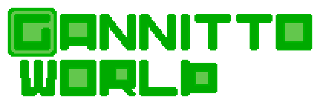
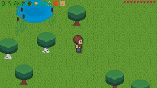

🌍 **Language:** English | [Русский](README.ru.md)
# Game Description
**Gannitto World** is an open-source indie sandbox game. It features a top-down pixel art style. The project is written in Python using the pygame graphics library, alongside numpy, vnoise, and others.  
It includes many diverse mechanics, such as:
- Procedural world generation
- Multiplayer
- Mob logic
- Building system
- Dynamic lighting

# Download the Game (for Players)

Standalone builds that do not require Python to be installed will soon be available in the **[Releases](https://github.com)** section. In the future, users will be able to download the archive for their OS, extract it, and run the executable file.

# Installation from Source (for Developers)

1. Clone the repository  
   Use the `git clone` command, or click Code -> Download ZIP on the website and extract the archive.
2. Make sure Python is installed on your system. If it is not, install it:  
	- Windows  
	  `winget install Python.Python.3.14`  
	  Or from the official website:  
	  https://python.org
	- Linux  
	  Depends on your distribution.  
	  Arch: `sudo pacman -S python`  
	  Debian/Ubuntu/Mint: `sudo apt install python3 python3-pip -y`  
	  Fedora: `sudo dnf install python3`  
	  Similarly for other package managers.
	- MacOS  
	  `brew install python`  
	  Or download the .pkg installer from the official website:  
	  https://python.org
3. Navigate to the game directory  
   This depends on where you downloaded the source code, likely your Downloads or home directory.  
   `cd Gannitto-World-master`  
   If you downloaded the ZIP archive, there will be another `Gannitto-World-master` folder inside the first one. Navigate into that one.
4. Install dependencies  
   `pip install -r requirements.txt`
5. Run the main file  
   `python Gannitto_world.py`  
   If that doesn't work, try running it with the `-m` flag:  
   `python -m Gannitto_world`

# Project Future & Contributing
The game has undergone a major refactoring. The foundation for large updates is ready, and the project is now moving into open beta testing.

I have many ideas for future development and am looking for like-minded contributors:
* **Python developers**
* **Pixel-art artists and sound designers**
* **Plugin creators and testers**

If you want to help the project, check out the **[Issues](https://github.com/Gannitto/Gannitto-World/issues)** tab, submit a Pull Request, or contact me directly:  
https://t.me/@Gannitto

