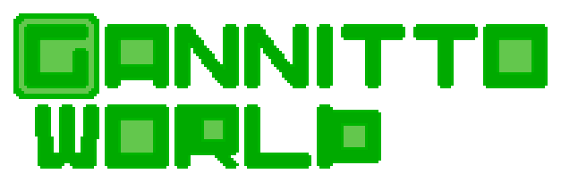
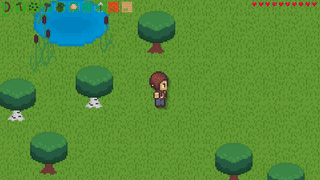

🌍 **Язык:** [English](README.md) | Русский
# Описание игры
**Gannitto World** - это инди-игра песочница с открытым исходным кодом. Она оформлена в стиле pixel art с видом сверху (top-down). Проект написан на Python с использованием графической библиотеки pygame. Так же используются библиотеки numpy, vnoise и др.  
Присутствует много разнообразных механик, например:
- Процедурная генерация мира
- Мультиплеер
- Логика мобов
- Система строительства
- Динамическое освещение

# Скачать игру (для игроков)

Готовые сборки, не требующие установки Python, скоро будут доступны в разделе **[Releases](https://github.com/Gannitto/Gannitto-World/releases)**. В будущем пользователи смогут скачать архив для своей ОС, распаковать и запустить исполняемый файл.

# Установка из исходного кода (для разработчиков)

1. Клонируйте репозиторий  
   Команда `git clone` либо на сайте нажмите Code, Download ZIP и разархивируйте.
2. Убедитесь, что в системе установлен Python. Если его нет, то установите его  
	- Windows  
	  `winget install Python.Python.3.14`  
	  Либо с официального сайта  
	  https://www.python.org/downloads/
	- Linux  
	  Зависит от дистрибутива.  
	  Arch: `sudo pacman -S python`  
	  Debian/Ubuntu/Mint `sudo apt install python3 python3-pip -y`  
	  Fedora `sudo dnf install python3`  
	  Аналогично с другими пакетными менеджерами.
	- MacOS  
	  `brew install python`  
	  Либо с официального сайта скачайте .pkg установщик  
	  https://www.python.org/downloads/
3. Перейдите в директорию игры  
   Зависит от того, куда вы скачали исходный код. Скорее всего, это загрузки или домашняя директория.  
   `cd Gannitto-World-master`  
   Если Вы скачивали архивом, то внутри Gannitto-World-master будет ещё одна Gannitto-World-master. Перейдите в неё.
4. Установите зависимости  
   `pip install -r requirements.txt`
5. Запустите главный файл  
   `python Gannitto_world.py`  
   Если не сработало, попробуйте использовать с флагом -m:  
   `python -m Gannitto_world`

# Будущее проекта и участие в разработке
Игра прошла через масштабный рефакторинг. Фундамент для крупных обновлений готов, и сейчас проект переходит в стадию открытого бета-тестирования.

У меня много идей для развития, и я ищу единомышленников:
* **Python-разработчиков**
* **Pixel-art художников и саунд-дизайнеров**
* **Создателей плагинов и тестировщиков**.

Если хотите помочь проекту, загляните во вкладку **[Issues](https://github.com/Gannitto/Gannitto-World/issues)**, создайте Pull Request или свяжитесь со мной:  
https://t.me/@Gannitto
